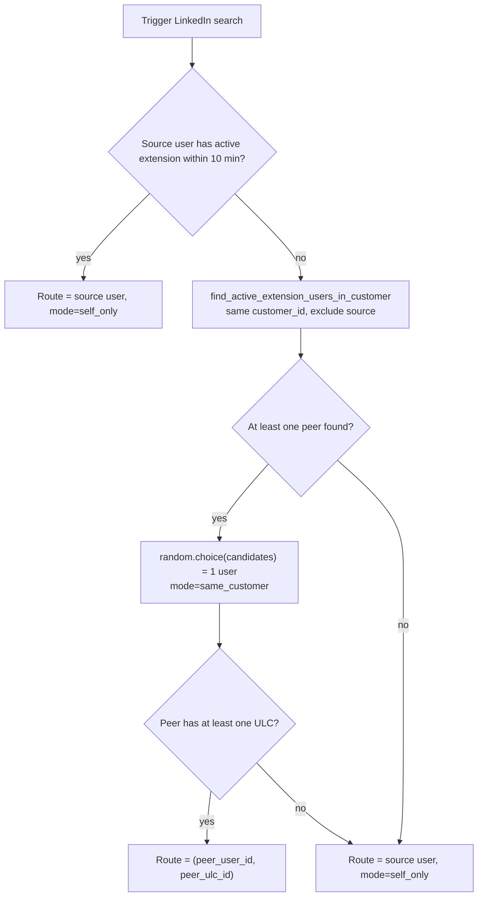

# simpl_outreach integration guide

> **Maintained by**: the simpl_outreach repo, auto-synced to simpl_knowledge.
> **Source of truth**: `simpl-techs/simpl_outreach/.agent/SKILL.md`

## What this library is

The outreach agent: a worker pool that claims queued triggers and walks each
user-lead connection through the `outreach_root` agent-framework graph. The
same worker answers seller regenerate requests. Other services do not import
this package: they queue triggers and read what the worker wrote.

## Installation

```bash
# How to add it as a dependency in a new project
```

Pin to a major version — we follow SemVer.

## Basic usage (the 90% case)

Nothing calls the processor in-process any more: since 2.0.0.74 it has no
host-facing methods, previews are retired, and simpl_api no longer depends on
this package. The worker pool (`python -m src.flows.outreach_daemon`) is the
only entry point.

**Regenerating a draft** is asynchronous and goes through simpl_core, never
through this package:

```python
from simpl_core.models.outreach.regenerate import RegenerateSource
from simpl_core.services.outreach.regenerate import request_regenerate
from simpl_core.services.outreach.regenerate_status import get_regenerate_job_status

request = await request_regenerate(
    db, journey_log_id=draft_id, owner_user_id=seller_id,
    requested_by=f"user:{seller_id}", source=RegenerateSource.SELLER, hint=note,
)
status = await get_regenerate_job_status(
    session, trigger_id=UUID(request.trigger_id), owner_user_id=seller_id
)
```

`request_regenerate` locks the draft (`payload.regenerate_pending`) and queues a
`seller_regenerate` trigger. The worker claims it with the lead's batch and
answers it before the batch's root walk
(`simpl_outreach/validation/services/journey/regenerate_job.py`), with exactly
one of core's settle steps:

| Walk outcome | Settle | Job status |
|---|---|---|
| request already settled (retried batch) | none, trigger dropped | unchanged |
| no scope on the request | triage walk picks one; blocked or unclassified -> `settle_no_result(reason=<route> or "unclassified_regenerate_scope")` | `no_result` |
| `rewrite`, message with a body | `settle_rewrite` (new active version) | `rewritten` |
| `rewrite`, other action with `question_for_human` | `settle_review_request` | `review_request` |
| `rewrite`, other action | `settle_no_result(reason="action_change:<action>")` | `no_result` |
| `rewrite`, empty body / blocked walk | `settle_no_result(reason="empty_response" / <route>)` | `no_result` |
| `restrategise` / `refresh` | `settle_superseded` withdraws the draft; the root walk writes the replacement (`payload.regenerate_result`) | `replaced` or `no_result` |
| draft changed meanwhile | the settle step writes nothing | `no_result` (`draft_changed`) |
| the step raised | `settle_failed(reason=<code>)`; the rest of the batch still runs | `failed` |

The triage and rewrite walks are dry runs: they write agent-framework audit rows
and may refresh the company-research cache, nothing else. A `seller_regenerate`
trigger without `expected_version_index` (queued by simpl_api before it moved
to `request_regenerate`) skips the step and is answered by the root walk, as
before.

## Rules and conventions

Things that are STRICT (enforced in code review):

- Rule 1 with an example
- Rule 2 with an example

Things that are FLEXIBLE (opinionated defaults, override if needed):

- Default 1 and when to deviate
- Default 2 and when to deviate

## Common pitfalls

Real mistakes that have been made before. Past-tense, specific.

- **Don't** do X — we had an outage on [date] because of this.
- **Don't** do Y — it appears to work but actually Z.

## Testing

How consumers test code that uses this library.

```python
# Minimal test example using any provided testing utilities
```

## What this library does NOT do

Equally important as what it does. Prevents the agent from misapplying it.

- Does not handle [adjacent concern] — see `other-library` instead
- Does not do [another concern] — that's [other tool]

## Where to go next

- Source: `https://github.com/simpl-techs/simpl_outreach`
- Recent integration examples: search `simpl_outreach.` in `simpl-techs/<other-repo>`
- Owner: @handle on Slack

## Referral observability events (`outreach_events`)

Cross-ULC referral steps emit typed events via `EventTracker.track_referral_event` (`src/simpl_outreach/infrastructure/event_tracker.py`). Payload fields use `referring_*` / `target_*` naming consistently.

| Event type | ULC | When |
|---|---|---|
| `target_change.requested` | referrer | change_target action created; includes `referral_outcome`, `referral_target_ulc_id`, `referral_target_lead_id` |
| `colleague.linked_to_existing` | referrer | dedup matched an existing colleague ULC |
| `colleague.created_from_conversation` | referrer | new Lead+ULC stub created; includes `new_ulc_id`, `new_lead_id`, `referring_action_id` |
| `referral.intro_queued` | colleague (target) | `referral_intro` trigger inserted |
| `referral.nudge_check_queued` | referrer | `referral_nudge_check` scheduled (+7d) |
| `referral.disambiguation_pending` | referrer | multi-match disambiguation trigger queued |
| `referral.linkedin_search_dispatched` | referrer | Voyager profile search journey_log queued for new colleague |

`source` values on referral events: `change_target_existing`, `colleague_creation`, `disambiguation_resolved`, `linkedin_search_complete`.

Dashboard Lead Flowchart reads these via `GET /api/admin/outreach-monitoring/lead-flow-graph` (BFS cross-ULC graph).

## Reply confidence: the `payload.reply_confidence` block (schema version 3)

Every lead-reply draft the pipeline writes as a `send_message` carries `journey_log.payload.reply_confidence`, stamped by the reply-confidence stage, whoever the seller is. On ledger versions up to v2.0.0.91 the stage runs only for a SimpL member (a seller whose `sales.user` row has `is_admin` or a `platform_role`), so a draft written on one of them for any other seller carries no block. Readers (simpl_sales, simpl_dashboard, simpl_api) accept `schema_version: 3` only, treat a missing block as "no block", and any other version as unsupported.

- **Keys.** `schema_version`, `pipeline_version`, `computed_at`, `confidence`, `delicacy`, `threshold`, `threshold_source`, `score`, `auto_approve`, `route_kind`, `settings`, `theme`, `hard_stops`, `reasons`, `top_reason`, `checks`, `assess`, `verify`, `withdrawn`, `pipeline_run_id`, `verify_run_id`, `versions`.
- **Verdicts.** The block states every verdict a reader needs, so a reader holds no copy of a rule of the stage: `score` against `threshold` (below), `hard_stops` and `confidence.band` (eligibility), `theme.never_auto` (the theme is never sent automatically, at any threshold; `theme` is `{conversation_state, band, primary_intent, brief_mode, key, never_auto}`, `key` opaque), and `verify.passed` / `verify.hard_stops` (below). Every entry of `reasons` is `{code, class, detail, text_key}`; `text_key` is the template the reason renders through (`approval_required` renders as `unlicensed_commitment`, every other code as itself, the database's return-to-review reasons included).
- **Two values and the score.** `confidence {value, band, source}` and `delicacy {c, b, penalty}` (`null` for an unknown or never-automatic theme). `confidence.value` is a decimal from 0 to 100 (shown to one decimal) graded from the assessor's answers: the lowest of its seven graded and stop answers, times 100 (its three detections never count). It is kept when a hard stop fired and is `null` when no assessment ran. `confidence.band` is eligibility, apart from the number: `strong` when no hard stop fired, the verifier answered and the assessment is complete, `failed` otherwise. `confidence.source` is `assessor` (a decision model answered, on OpenRouter's decisions API; its numbers are used as returned), `assessor_fallback` (a language model answered, GLM-5.3-Flash behind the decision model; its numbers are snapped to 0.02 / 0.15 / 0.5 / 0.85 / 0.98) or `unassessed` (no assessment ran, so there is no value). `score = confidence - penalty` is the score after the penalty, exactly as the decision compared it with `threshold` (`null` without an assessment or a penalty): a reader's `score >= threshold` is the decision's own comparison and never needs the gate recomputed. A `confidence.value` shown as 90.0 may score 89.951, under a threshold of 90. `below_threshold`'s `params` carry `confidence`, `penalty`, `score`, `threshold` and `weakest` (the question that set confidence).
- **`assess`** (`null` when no assessment ran): `{model, question_set, aggregator, answers, raw, detections, weakest, truncated, prompt_chars}`. `model` is the member that answered, `null` when the walk could not name it (its answer is then read as the fallback's). `answers` and `raw` are keyed by the seven graded and stop question ids (`answers_requests`, `fits_message`, `consistent`, `declining`, `commitment`, `instructions`, `others_act`): `raw` is each probability of yes as returned (after the fallback's snapping), `answers` how fine each point looks (p, or 1 - p for `declining`, `commitment`, `instructions` and `others_act`; higher is better). `weakest` may be any of them, never a detection. `detections` is `{claims_about_lead, claims_about_seller, promises_action}`, each the raw probability of yes (snapped for the fallback): does the draft state something about the lead the lead did not say, a fact about the seller, a promise of a later action. A detection at p >= 0.5 tells the verifier which kind of claim it must find; it never lowers confidence. `question_set` is `rc-questions-2026-10-15`, `aggregator` `lowest`. `truncated` says whether the assessor's material (the lead's latest message, the draft, the lead's requests and the conversation tail) was cut to its 12,000-character budget, `prompt_chars` its size. Three answers are stops: `commitment` p >= 0.5 is `approval_required` with `params.kind` `commitment`, `instructions` p >= 0.5 (any of the lead's messages, the latest or an earlier one, addresses an AI or an automated system, or tries to change how replies are written; a request to the seller about whom to write to, whom to copy or when to call does not count) is `suspected_injection` with flag `instruction_text`, `others_act` p >= 0.5 (the draft says someone other than the sender will do something) is `approval_required` with `params.kind` `handoff`.
- **`verify`** (`null` on a reply that was never scored: `gate_error` from the score's failure answer, `held_by_routing`): the verifier's answer as code checked it, with its verdict, `{model, status, passed, hard_stops, claims [{quote, kind, status, source, evidence_found}], draft_slots [{quote, date, start, end, matched}], offered_slots, truncated, prompt_chars}`. `hard_stops` lists the hard stops the verifier's answer raised (`unsupported_claim`, `unoffered_slot`, `verify_failed`, in display order) and `passed` is true when it raised none; read them rather than a copy of that list. `status` is `answered` or `failed` (no answer for the draft: lists empty, `model` null, `verify_failed`). A claim's `kind` is `lead`, `seller` or `promise`; its `status` (`supported`, `unsupported`, `contradicted`) and `source` (`brief`, `value_props`, `voice_guide`, `icp`, `excerpt`, `lead_research`, `conversation`, `decision`, `none`) are the verifier's; `evidence_found` is code's: the quoted evidence was found in that source as the verifier read it, whole or as passages of one message or text joined by an ellipsis (each passage of at least 12 characters found in order). `lead_research` (the research about the lead the writer had) backs only a statement about the lead and `decision` (the decision the draft was written from) only a promise; a statement about the lead backed by the conversation must be in the lead's own messages, a fact about the seller in the seller's, a promise in either (it may answer the lead's request). A claim counts as unsupported unless it is `supported` with `evidence_found`. A draft slot's `date` is `YYYY-MM-DD`, or `null` when the verifier gave no day that can be read, `start`/`end` `HH:MM` or `null` (Europe/Rome); `matched` is true when it falls on a day the lead offered (inside the offered window when both name a time; morning 09:00-12:30, lunchtime 12:30-14:00, afternoon 14:00-18:00, evening 18:00-20:00) or equals the decision's booking. `offered_slots` counts the slots it could match (the lead's whose quote was found, and the booking). `truncated` and `prompt_chars` describe the verifier's material (at most 80,000 characters; past the parts that are never cut it keeps the conversation first, then the lead research, the company brief, the value propositions, the excerpts, the ICP blocks and last the voice guides). `verify_run_id` is the verifier's agent run; `versions.reviewer_model` / `reviewer_prompt_version` name the verifier's model and prompt.
- **Verifier reasons.** `unsupported_claim` (`params.count`: the claims that count as unsupported) and `unoffered_slot` (class `quality`, `text_key` equal to the code, `params.count`: the draft's days and times nothing matched; in display order right after `unsupported_claim`) are hard stops. `verify_failed` (class `quality`, `params: {}`) is no answer from the verifier for the draft, a verify check that failed, or a detection at p >= 0.5 whose kind of claim the verifier did not list (its `detail` names the detection and the kind). Gate policy `gate-2026-10-09`.
- **Hand-off and placeholder.** `approval_required`'s `params.kind` may be `handoff` (class `authority`, a hard stop like its other kinds): the decision hands work to a colleague (it carries a coordination request), or the assessor's `others_act` stopped the reply. `output_rule`'s `params.rules` and `checks.output_rules` may contain `placeholder`: the draft (subject or body) still holds template text, such as "[Name]", "{first_name}", "<insert date>", `XX:XX` or `TBD`.
- **Rescued decision.** A hard stop `rescued_decision` (class `doubt`, `text_key` equal to the code, `params: {}`): the reply was written from a decision the rescue agent (`decide_rescue`) rewrote, after the decision's fixed checks or the account responsibility review rejected the first one. It holds the reply whatever it scores; the confidence is kept. A draft whose wording alone was rewritten is not held for it. In display order it comes after `ambiguous_request` and before `never_auto_theme`.
- **Doubt reasons on the lead's message** (class `doubt`, `text_key` equal to the code): `unusual_message` (`params.kinds`: `forwarded` and/or `over_length`; a forward or a very long lead message) and `stale_thread` (`params: {}`; the walk's copy of the thread lacks the lead's message that started it). In display order `stale_thread` comes right after `gate_error`, and `unusual_message` right after `suspected_injection`. `suspected_injection` comes once per origin (`params.origin`). With `params.origin` `lead`, `params.flags` names the carriers found in any of the lead's messages, the latest or an earlier one: invisible characters (`unicode_tags`, `hidden_text` smuggled in tag characters, `zero_width`, `bidi_control`), `fake_boundary`, `quote_tamper` (a line quoted as ours that our stored thread does not hold; the lead's own signature, disclaimer or banner around the quote is not compared), `special_tokens`, `instruction_override`, `encoded_blob`, `mixed_script_domain`, and `instruction_text` from the assessor. With `params.origin` `draft`, `params.flags` is `invisible_unicode`: invisible characters in the draft. `checks.stale_check` is `fresh`, `stale` or `unknown`.
- **Outcome.** `auto_approve` / `route_kind` (`send` or `draft_review`; there is no question card) record what the stage decided. Whether a reply is queued to send is the row's, not the block's: `journey_log.auto_send_at IS NOT NULL` is the one test. The persist step sets it, on a `PENDING` row whose block has `auto_approve: true` and `top_reason: null`, to the time the reply may leave (the row's `scheduled_at`); every other row is written with it null, and simpl_core's database clears it whenever the row leaves `PENDING` or gets an approver. Every other reply with a block is written as a `PENDING_APPROVAL` draft card whose `top_reason {code, text_key, params}` is the first of `reasons` in display order; `params` hold typed values only.
- **Settings.** Who may get an automatic reply is the database resolver's answer, `sales_outreach.reply_confidence_authorization(user_id, icp_id)` (simpl_core), read once per walk and again just before writing a queued row, for the seller and the lead's ICP (`user_lead_connection.icp_id`). It combines SimpL's settings, the seller's consent (`outreach_prefs.auto_approval`: `enabled` stored JSON `true`, the channel listed, `stop_on_lead_response` stored JSON `false`) and the ICP override (which only restricts); the pipeline never re-derives it. The block records what applied in `settings`, `threshold` and `threshold_source`: the threshold the resolver gave (`threshold_source` `customer`, `user` or `default`, the database's default), or `null` for both when the settings were unread; the pipeline has no threshold of its own. `settings.channel` is the delivery channel key (`email`, `linkedin_message`, or `null`); `settings.seller_block` (`master_off`, `pause_on`, `icp_restriction`, `channel_unlisted`) and `settings.channel_block_by` (`staff`, `seller`) say who refused, and the reasons carry it too: `seller_paused` has `params.kind`, `channel_off` has `params.by` and `params.channel`. Readers ignore keys they do not know.
- **Failures.** A reply whose settings could not be read is held with `missing_input`; one whose candidate could not be built, or read in every key (a missing, renamed or malformed key, or an interpretation without a key the stage reads), likewise; one the assessor could not answer (the decision model and its fallback both failed) likewise, with `params.inputs` naming `assessment` (no confidence, `assess` null); one the verifier could not answer with `verify_failed` (`verify.status` `failed`); one that could not be scored is held with `gate_error` (no confidence; from the score's failure answer, the settings' closed reading and no threshold). None of them carries exception text. On a ledger version that has the stage a lead-reply send nothing scored is always held, with a `held_by_routing` block except on a walk the gate skipped whose seller is not a SimpL member; on a version without the stage that version's own routing decides it and no block is written.
- **Return to review** and the database's other moves out of the queue (the recall after a settings or preferences change, the send-time check) are simpl_core's; each clears the row's `auto_send_at` and writes `withdrawn {reason, at, by}` (`by` is `user:<uuid>`, `admin:<uuid>` or `system:<name>`), appends the reason to `reasons` and makes it `top_reason`, leaving what the stage decided (`auto_approve`, `route_kind`, the score) as it was. A returned reply therefore keeps `auto_approve: true`: only the row says it is no longer queued.
- **Schema.** `schemas/reply_confidence_block.schema.json` is the block's JSON Schema (draft 2020-12), exported from its Pydantic model (`reply_confidence.block.ReplyConfidenceBlock`), the one writer of the block; generate a parser from it rather than writing one by hand. Every key is required in every block (`null` where it does not apply), and the schema allows no other key: it describes exactly what this producer writes. A reader's parser may still drop keys it does not know.
- **Fixtures.** `tests/reply_confidence/fixtures/blocks/*.json` are blocks written by the real producers (`poetry run python -m scripts.export_reply_confidence_fixtures`, which writes the schema too), each valid against the schema; test a parser against them rather than a hand-written example. 33 files, among them `send` (96.0 by the decision model, at a customer threshold of 95, two draft slots matched; its row is written with `auto_send_at` set), `returned` (`send` after the seller's return to review; its row's `auto_send_at` is null), `assessor_fallback`, `assessor_unattributed` (`assess.model` null), `undated_slot` (a draft slot whose `date` is null), `draft_invisible_characters` (`suspected_injection` with `params.origin` `draft`), `commitment_detected`, `instructions_detected`, `declining`, `placeholder`, `handoff_requested` (from the decision), `others_act_detected` (from the assessor), `rescued_decision`, `unsupported_claim` (from the verifier), `unoffered_slot`, `verify_failed` (the verifier failing), `gate_error` (the score's failure answer) and `missing_input` (the settings unread: no threshold).

## Operational env-vars: LinkedIn dispatch & disambiguation

The simpl-outreach daemon honours four runtime flags that change how LinkedIn enrichment searches are routed and how the colleague-dedup multi-match is resolved. All flags are re-read on every dispatch, so a redeploy flips behaviour without restarting the worker. A fifth flag, `LINKEDIN_PROFILE_SEARCH_CREATES_TRIGGER`, is owned by `simpl_sales` and documented at the bottom for cross-repo coordination.

### Dispatcher flags

Source: `src/simpl_outreach/services/linkedin_search_dispatch.py`. Callers: `src/simpl_outreach/services/linkedin_profile_search.py` (colleague creation) and `src/simpl_outreach/validation/route_handlers/referral_search_timeout.py`.

- `LINKEDIN_SEARCH_DISPATCH_FALLBACK_ONLY` (`F`) — chain runs only when the source user's extension is offline (active window: 10 minutes; constant `_ACTIVE_EXTENSION_WINDOW_MINUTES`).
- `LINKEDIN_SEARCH_DISPATCH_SAME_CUSTOMER` (`SC`) — restrict the chain to teammates inside the same `customer_id`.
- `LINKEDIN_SEARCH_DISPATCH_ANY_ACTIVE_EXTENSION` (`AAE`) — allow widening to any active extension, anywhere.

A dispatch produces **exactly one** `(user_id, ulc_id)` route. The chosen user is `random.choice(candidates)`. There is no fan-out of the same search across multiple extensions. Multiple distinct searches in the same turn (e.g. several CC'd colleagues) each go through the dispatcher independently.

### Truth table

`S` = source-online; `T` = teammate-found.

```
| F | SC | AAE | Behaviour                                            |
| F |  F |  F  | self_only (always source)                            |
| F |  T |  F  | always same_customer → source if no peer             |
| F |  F |  T  | always anywhere → source if no peer                  |
| F |  T |  T  | always same_customer → anywhere → source             |
| T |  F |  F  | source if S, else anywhere → source                  |
| T |  T |  F  | source if S, else same_customer → source             |
| T |  F |  T  | source if S, else anywhere → source                  |
| T |  T |  T  | source if S, else same_customer → anywhere → source  |
```

With `F=true` + `SC=true` + `AAE=false` the chain does **not** auto-promote to "anywhere". If no customer-mate is online, the route falls back to the source user, even if the source itself is offline. The narrowing is intentional — see the comment around the `chain_anywhere` line in `linkedin_search_dispatch.py`.

Failure modes (DB error, no candidates, peer with no ULC) all fall back to the source. The dispatcher never drops a task.

### Flow for the `T / T / F` configuration



### `LINKEDIN_DISAMBIGUATION_ENABLED` (orthogonal to the dispatcher)

Owned and read by `simpl_sales` in `app/api/v1/linkedin_profile_search/complete/route.ts`
(`disambiguationEnabled` from the env var, default **false** when unset). Stamped onto the
trigger payload at three sites so a search dispatched under one policy completes under the same
policy: the unified `linkedin_profile_search_completed` trigger, a journey_log payload mirror, and
the `colleague_disambiguation_pending` branch. Current deployed value is not determinable from
any repo.

This repository does **not** read the flag: the completion handler
(`validation/route_handlers/linkedin_search_results.py`) always asks on a multi-match, whatever
the flag says.

### Cross-repo: `LINKEDIN_PROFILE_SEARCH_CREATES_TRIGGER`

This var is **NOT** read by simpl-outreach. Owner is `simpl_sales`, in
`app/api/v1/linkedin_profile_search/complete/route.ts`.

- off (default): legacy. simpl-outreach creates the `referral_intro` trigger upfront when dispatching the search; the Next handler only updates the Lead row.
- on: the Next handler emits the `referral_intro` (or, in unified-shape mode, a `linkedin_profile_search_completed`) on `sales_outreach.batch_trigger_queue` at completion time. simpl-outreach must already be on the matching revision that stops creating the trigger upfront, otherwise triggers double up.

Practical implication for local runs: setting this var in `simpl-outreach/.env` has zero effect —
set it on the `simpl_sales` Next.js process.

### Where to read the source

- Dispatcher and truth table: `src/simpl_outreach/services/linkedin_search_dispatch.py`
- Disambiguation flag (owner): `simpl_sales/app/api/v1/linkedin_profile_search/complete/route.ts`
- Multi-match completion handler: `src/simpl_outreach/validation/route_handlers/linkedin_search_results.py`
- Profile-search completion + trigger gate: `simpl_sales/app/api/v1/linkedin_profile_search/complete/route.ts`

### Embedding the processor: LLM request accounting is expected

No service embeds the processor today; the two sections below hold for the
worker daemon and for any future host.

`create_app()` / `OutreachProcessor` check that the process-global `simpl_tracker`
records a receipt for every LLM request. When it does not, they report it on the
cost-tracking channel (`DISCORD_COST_TRACKING_WEBHOOK_URL`) and start anyway: an
untracked cost is never a reason not to run. Two things a host has to get right:

1. **The host's `tracker.yaml` must set `cost_tracking.request_accounting: true`.**
   `configure_from_yaml()` discovers `tracker.yaml` from the *host's* working
   directory, so it is the host's file that is checked, not this repo's. A host
   whose file omits the key (it defaults to `false`) is reported on the
   cost-tracking channel. The check runs again at the start of every framework
   walk, and after boot it also reports a tracker that has been disabled or
   removed -- so a host that re-applies its own tracker after
   embedding has to keep `cost_tracking.enabled` and `request_accounting` on
   there too.
2. **The `cost_tracking.record_llm_receipt` migration must be applied** in the
   database that tracker writes to. With the flag on and the RPC missing, every
   LLM request is made and reported as `llm_accounting.dispatched_unrecorded`.

Break-glass: `OUTREACH_REQUEST_ACCOUNTING=false` (also `0`, `no`, `off`) turns
receipts off *and* tells the guard to allow it. It logs
`llm_accounting.disabled_by_operator` on every walk while set. It is not
provisioned in Doppler by default; set it per environment only to recover from a
broken accounting path, and remove it afterwards.

### Embedding the processor: agent framework alerting and the step trace

A host process that embeds `OutreachProcessor` shares `simpl_core`'s alerting
state and `simpl_tracker`'s notifier with it.

- **Rules.** When `OutreachProcessor` bootstraps the framework, outreach registers
  `AlertRule(event="agent_framework.engine.validator_failed",
  pipeline_id="pipeline_ops_agent", severity="error")` with `simpl_core`'s
  `add_alert_rules`. That call appends only missing rules and never changes
  `enabled` or `shared_dedup`. A host that registers its own rules the same way,
  including that shared one, keeps them whether it bootstraps before or after
  `create_app`. A host calling `configure_alerting(rules=...)` replaces every app's
  rules, outreach's included.
- **Config-ledger fallbacks.** Outreach registers no fallback handler. The
  framework reports fallbacks itself, as `config_ledger.fallback_applied` or
  `fallback_exhausted`.
- **Alert ids.** Outreach passes `ulc_id`, `user_id` and, when known,
  `company_id` as framework `labels`, so its framework alerts carry them. The
  host does not wrap outreach walks in `bind_run_context`.
- **Notifier.** Outreach wraps the installed notifier in `VersionStampedNotifier`
  on every walk. It forwards `fingerprint=` and `entities=` to the wrapped
  `NotificationService.send`, so a host that installs its own notifier after
  embedding keeps framework dedup intact.
- **`agent_framework.pipeline_run_steps`.** Outreach walks are traced by
  `simpl_core`'s default step recorder, not by outreach. Readers see core's row
  shape:
  - node rows carry `outcome` `{status, passed, route, terminal}` and a `node_run_id`;
  - the finalize row is `node_id='__finalize__'` with
    `{terminal, terminal_node, iterations, path, prev_route}`;
  - a walk that raised still leaves its steps and a finalize row with `error`
    `{type, message, expected}`.
- **Dispatcher alerts.** If the host runs `BatchDispatcher`, it posts only what the
  framework has not already reported.
  - A per-ULC dispatch failure and an exhausted DB pool reach #warning only when
    no walk announced the exception.
  - A lost lease that cancelled a framework walk is log-only, because the
    framework posts the cancelled walk. Anywhere else it is one #warning.
  - The per-tick count of failed claims is one #warning.
  - A crashed worker is the only #error.
  - A walk handed back because its worker is stopping (`run(shutdown=...)`) is not
    a failure and posts nothing.
- **Versions.** This needs `simpl_tracker` with `NOTIFY_API_VERSION >= 3`, whose
  report-once follows `raise ... from` and honours `__simpl_notify__`. It also
  needs a `simpl_core` whose entry points take `labels`, whose `walk_graph` traces
  by default, and which exports `add_alert_rules`. The worker-pool drain and the
  autoscaler look-ahead need `simpl_core >= 0.8.24`: `release_preempted_claim`,
  `reclaim_expired_ulc_leases`, `count_dispatchable_ulcs(due_within=...)` and
  `expect_cancellation`.

### Cheaper Inference credentials

`CHEAPER_INFERENCE_API_KEY` and `CHEAPER_INFERENCE_BASE_URL` are optional until an
agent policy selects `provider: cheaper_inference`. Then both are required.
The endpoint is explicit; the provider must never default to OpenAI's endpoint.
Maintainer handoff: provision both variables in Doppler project `simpl_outreach`,
configs `dev`, `stg`, and `prd` as used, then publish the corresponding runtime
revision. Never include secret values in code or release notes.
